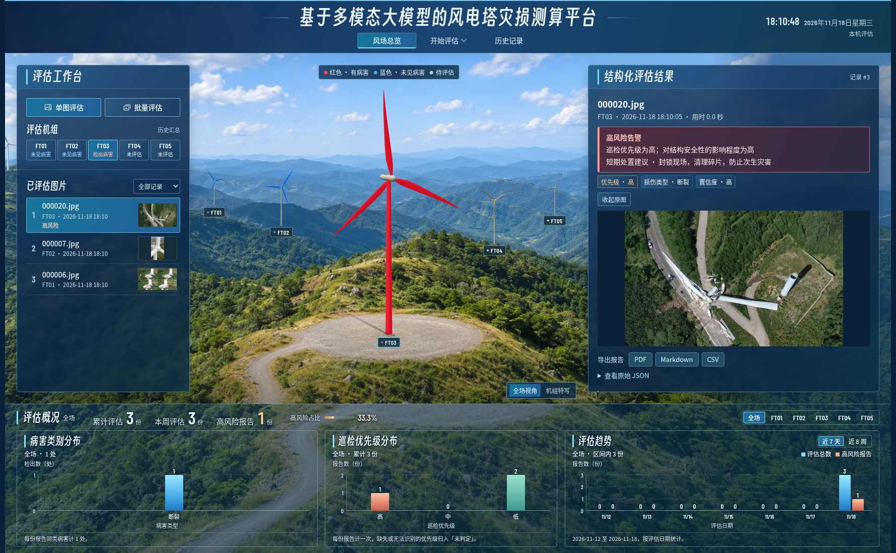

# 基于多模态大模型的风电塔灾损测算平台



*风场总览，使用仓库内置巡检样例展示。*

平台支持指定风机的单图与批量评估，在风场总览中展示病害部位和结构化报告，并支持本地历史记录及 PDF、Markdown、CSV 导出。

## 预览界面

源码附带风场场景及内置巡检样例。仅预览界面时，安装 FastAPI 和 Uvicorn 即可。在项目根目录运行以下命令。

```bash
python -m venv .venv
source .venv/bin/activate
python -m pip install fastapi uvicorn
python -m uvicorn preview_ui:create_preview_app --factory --host 127.0.0.1 --port 7861
```

浏览器打开[风场总览](http://127.0.0.1:7861/screen#farm)。预览模式可查看内置样例和页面布局。

## 放置 Qwen3.5-4B 模型

仓库已预留 [`qwen3.5-4b/`](qwen3.5-4b/) 目录。从项目根目录运行以下命令，将第一行中的路径替换为你本机存放完整微调模型的目录。

```bash
model_dir="/实际路径/微调模型"
cp -a -- "$model_dir"/. ./qwen3.5-4b/
```

复制后，`config.json` 应直接位于 `qwen3.5-4b/config.json`。下面是本项目已验证的双分片模型目录结构。

```text
qwen3.5-4b/
├── config.json
├── generation_config.json
├── processor_config.json
├── tokenizer.json
├── tokenizer_config.json
├── chat_template.jinja
├── model.safetensors.index.json
├── model-00001-of-00002.safetensors
└── model-00002-of-00002.safetensors
```

模型文件只保存在本机，Git 默认忽略放入该目录的权重和配置。只预览界面时可以跳过这一步。

## 运行真实评估

放好模型后，在已安装依赖的 Linux 推理环境中，从项目根目录启动平台。已验证的环境为 Python 3.12 和 NVIDIA RTX 4090。

```bash
bash start.sh --open
```

启动脚本优先使用 `~/.venvs/winddamage-infer/bin/python`，其次使用当前环境的 Python。默认打开[本机评估平台](http://127.0.0.1:7860/screen#farm)。在新环境可先运行 `python -m pip install -r requirements.txt`。首次评估会将模型加载到设备。

评估记录与归档图片分别存放在本机 `history.db` 和 `persisted_images/`，备份时请一同保存。
